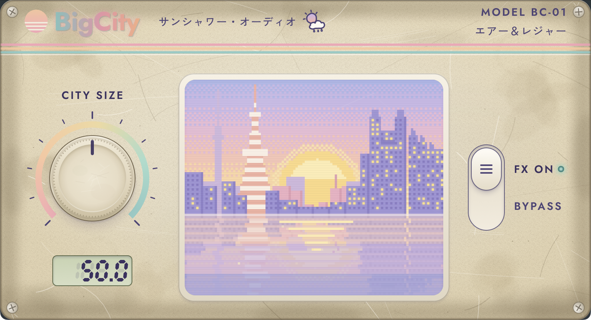

# BigCity

The sparkle of city pop, available with the twist of a knob ✨



Get it on Gumroad: https://sunshoweraudio.gumroad.com/l/bigcity

## Build

Prerequisites:

- macOS with Xcode (built with Xcode 27.1)
- CMake 3.22 or later
- The JUCE 8.0.15 submodule

```bash
git clone --recurse-submodules https://github.com/yakutaku/BigCity.git
cd BigCity
# If you cloned without --recurse-submodules:
git submodule update --init

cmake -B build -G Xcode -DCMAKE_OSX_ARCHITECTURES="arm64;x86_64"
cmake --build build --config Release
```

This builds a universal (arm64 and x86_64) VST3 for macOS 12 and later. It also builds a Standalone app, which is for development only. After each build, the VST3 copies itself to `~/Library/Audio/Plug-Ins/VST3`.

### Packaging

`tools/package.sh` builds the VST3, signs it and wraps it in a signed `.pkg` in `dist/`. Run it with `--notarize` to also notarize the installer and staple the ticket. It signs with the author's Developer ID certificates and notary profile, so it only runs on the author's Mac.

## Tests

The unit tests build with the project. To run them:

```bash
ctest --test-dir build -C Release
```

Validate the installed plugin with [pluginval](https://github.com/Tracktion/pluginval) at strictness 5:

```bash
/Applications/pluginval.app/Contents/MacOS/pluginval --strictness-level 5 --validate "$HOME/Library/Audio/Plug-Ins/VST3/BigCity.vst3"
```

## Repo map

| Folder | Contents |
|---|---|
| `Source/` | The plugin: DSP, parameters and UI components |
| `Tests/` | Unit tests, plus measuring tools (`ShelfCheck`, `AutoGainMeasure`, `CpuBenchmark`) |
| `assets/` | @2x UI images and the skyline window order, compiled into the binary |
| `docs/` | PRD, decision log, UI spec, Practical UI notes and beta results |
| `tools/` | `package.sh` (sign, package and notarize) and the skyline generator |
| `JUCE/` | JUCE framework (git submodule) |

## License

All rights reserved. See [LICENSE](LICENSE).
